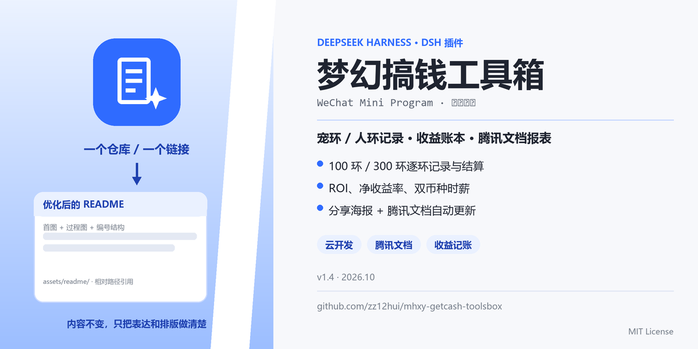
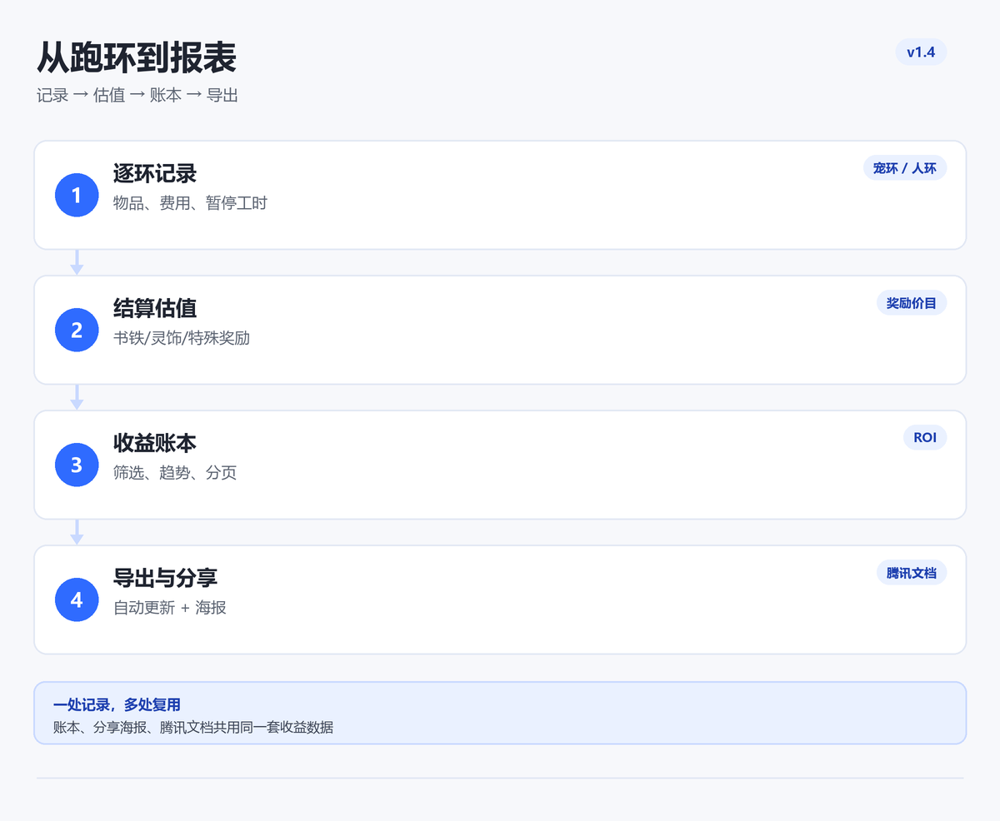

# 梦幻搞钱工具箱



微信小程序，给梦幻西游跑环玩家记账用。宠环 100 环、人环 300 环都能逐环记录，结算后按价目表估值奖励，算出这一轮到底赚了多少。

数据默认只放手机本地，不登录也能用；登录后可以整份备份到自己的微信云账号，换手机再恢复。

当前版本 **v1.4.2**：一屏首页、金价计算器、收益账本、分享海报、腾讯文档报表、联系客服。

> 🚧 **下一步计划（未实现）**：v1.5「收益中心」——通用玩法快速记账、活动收益排行榜、周期报表；方案见 [docs/PLAN-v1.5-profit-center.md](docs/PLAN-v1.5-profit-center.md)。当前版本不包含该功能。

---

## 1. 它是什么

跑环最烦的不是记不住环数，是算不清这一轮到底赚没赚。这个工具把三件事串起来：

- 记录：环数、任务、物品、花费，支持批量填充和撤销
- 估值：结算时按书铁 / 灵饰 / 特殊奖励参考价算收益，也能改实际成交价
- 复盘：账本里按角色、工具、周期筛，逐轮 ROI、净收益率、时薪都能看到，还能导出腾讯文档或分享海报

举个例子：一轮 100 环任务成本 300 万两，书铁按参考价估值 430 万两，净收益 130 万两，ROI 1.43；账本会把这笔和有效工时一起算进时薪。



## 2. 功能

### 宠环助手（100 环）

- 逐环记录任务类型、物品名与花费，支持批量填充、环号跳转、撤销
- 实时积分、书铁等级预测、奖励档位、PPR 控分建议
- 结算时记录实际奖励，自动统计成本；历史与统计（得分趋势、档位分布）
- 常用任务自动置顶、连续同类型快速记录、物品名记忆、震动反馈

### 人环助手（300 环）

- 300 环记录，100 / 200 / 300 段奖励分别记录，跨段批量填充有拦截
- 按角色等级给出书铁区间、灵饰/战魄提示
- 历史与统计（任务类型分布、费用汇总）

### 收益账本（v1.3）

- 每轮结算记录成本明细 + 收益明细（奖励按参考价自动估值，可改实际价）
- 自动计算净收益、投入产出比（1 : x）、净收益率、时薪、用时
- 历史列表显示每轮产出/净收益/ROI，可点开看成本与收益明细；旧数据标「未记账」可补录
- 收益账本页：按角色 / 工具 / 周期汇总总投入、总产出、净收益、ROI，含累计净收益折线
- 金额支持「万两 / 人民币」双币种显示（金价可配置），时薪同时给两种口径
- 有效工时：记录中可暂停/继续，结算按有效时长计算时薪；账本可看总工时、日均/月化收益、点卡成本、目标时薪达标情况
- 一键生成腾讯文档在线表格：总览 + 宠环/人环轮次明细（逐轮 ROI、净收益率、双币种时薪、奖励摘要），自动删除默认空表，生成后可直接打开；再次同步更新原文档
- 收益报表平均时薪分两行：第一行万两/时，第二行约等于人民币/时
- 一键分享收益报表：按账本当前数据生成海报图（净收益/ROI/时薪/趋势/小程序码），长字段自动换行或省略，可分享微信或保存相册
- 首页「收益账本」大栏目 + 我的页面入口：直接看累计净收益、ROI、时薪，点击进账本
- 我的页「联系客服」：直接打开微信客服会话，有问题可以直接发消息；不申请、不收集手机号（赞赏入口暂隐藏）
- 深空霓虹视觉（P0+P1）：首页/账本玻璃卡、渐变描边、迷你趋势条、图表逐帧绘制、TabBar 活跃胶囊；腾讯文档优先半屏打开
- 手机优先操作：热区加大、弹窗底部安全区、精简动效开关；高分辨率 / PC 大屏按 px 放大字号并固定间距，不会字体过小或模块间隙过大
- 术语统一：宠物环叫「宠环」，人物环叫「人环」
- iPad / 大屏：开启 `resizable`，支持横竖屏旋转与宽度自适应；iPad 横屏矮窗口首页自动压缩一屏，旋转后胶囊/导航位置会重算
- 首页金价计算器：默认 3000 万梦幻币 = 202 元，万两 ↔ 人民币双向自动换算，比例可自定义
- 首页单屏不滚动：收益账本 + 两列工具卡 + 金价计算器 + 8 宫格工具，常用功能一屏直达
- 底部导航固定 4 项：首页 / 宠环 / 人环 / 我的；结算弹窗底部操作栏固定，确认按钮不会被遮挡
- 账本支持多轮分页（每页 20 轮）；腾讯文档第二次同步会更新原文档，不用重复生成
- 首页「人环工具箱」：物品参考价、宠环预测/控分/批量填充、人环历史/统计/奖励记录一键直达
- 只有 1 轮也能出累计净收益图（首页迷你趋势 + 账本图表），不再提示“轮次不足”

### 账号与云备份（可选）

- 微信登录、昵称/头像（头像上传云存储）
- 云备份按角色全量上传，恢复时整份快照覆盖本地（会二次确认）
- 登录后个人中心可随时管理账号、退出登录

### 知识库

- 4 分类 FAQ、搜索、1 小时本地缓存，断网可看

### 其他

- 多角色（同一手机多开）数据隔离
- 导出 / 导入 JSON（剪贴板），导入带结构校验
- 隐私政策与用户协议页面

---

## 3. 技术栈

- 微信小程序原生开发（基础库 2.24.0）
- 微信云开发：云函数 + 云数据库
- ESLint 8 + Node.js 内置测试（`node --test`）

## 4. 目录结构

```
app.js / app.json / app.wxss     应用入口、云开发初始化、全局样式
custom-tab-bar/                   自定义 TabBar（首页 | 当前工具 | 我的）
pages/                            index / pet / chain / profile / faq / faq-detail
                                  login / feedback / manual / privacy / ledger
components/run-detail/            轮次明细抽屉（成本/收益/ROI，历史与账本共用）
utils/
  constants.js                    游戏常量与公式（纯函数，可直接单测）
  storage.js                      本地存储封装（按角色 uid 隔离 + 整账号导出/恢复）
  cloud.js                        云函数调用与 FAQ 查询封装
  faq-cache.js                    FAQ 本地缓存
  ring-cost.js                    价格与费用计算（价格 0 生效）
  ledger.js                       收益估值/ROI/周期过滤/多轮汇总
  reward-prices.js                奖励价目表（书/铁/灵饰/战魄/特殊奖励参考价）
  money.js                        梦幻币↔人民币换算、点卡成本、目标时薪
  task-usage.js / item-memory.js  常用任务排序、物品名记忆
  undo.js / ui.js                 撤销栈、震动开关
cloudfunctions/                   7 个云函数（见下）
tests/                            Node 单测（不参与小程序打包）
```

## 5. 云函数

| 函数 | 作用 | 说明 |
|---|---|---|
| `login` | 微信登录，返回 openid / isAdmin | 首次调用会创建 `users` 记录 |
| `syncUpload` | 全角色备份 | 入参 `roles[]`，按角色 + 数据类型分文档存储 |
| `syncDownload` | 读取全角色备份 | 返回 `roles[]`，客户端整份恢复 |
| `submitFeedback` | 提交意见反馈 | 写入 `feedbacks` |
| `docsReport` | 生成腾讯文档收益报表 | 创建在线表格 + 写数据 + 设为链接可读；需在云函数环境变量配置腾讯文档三元组 |
| `init` | 初始化 FAQ 数据并绑定管理员 | **仅管理员可调用**，见下方部署步骤 |

## 6. 云数据库集合

| 集合 | 用途 | 建议权限 |
|---|---|---|
| `faq_categories` | FAQ 分类 | 所有用户可读 |
| `faq_items` | FAQ 条目 | 所有用户可读 |
| `users` | 微信登录用户 | 仅创建者可读写 |
| `user_sync_data` | 云端备份 | 仅创建者可读写 |
| `feedbacks` | 用户反馈 | 仅创建者可读写（写入走云函数） |
| `admins` | 管理员 openid 白名单 | 仅云函数可读写 |

> 云数据库不会自动建集合，也不支持缺失索引的复杂查询。第一次部署时请在云开发控制台手动创建以上 6 个集合；FAQ 列表查询（`isActive + orderBy`）建议按需加索引。

## 7. 快速开始 / 本地运行部署

1. **安装微信开发者工具**（完整功能需微信扫码登录；游客模式只能编辑本地项目）。
2. **准备 AppID**：云开发需要正式注册的小程序 AppID，测试号不支持云开发。仓库里的 `<YOUR_APPID>` 和云环境 `<YOUR_CLOUD_ENV>` 是作者自己的环境，**他人使用请替换成自己的**：
   - `project.config.json` → `appid`
   - `app.js` → `wx.cloud.init({ env: '你的云环境ID' })`
3. **导入项目**：选择本仓库根目录。
4. **创建集合**：按上表在云开发控制台创建 6 个集合。
5. **部署云函数**：`cloudfunctions/` 下 6 个目录分别右键「上传并部署：云端安装依赖」（已锁定 `wx-server-sdk@3.0.4`）。
6. **配置 `init` 鉴权**（二选一）：在云开发控制台 → 云函数 `init` → 配置 → 环境变量中添加：
   - 小程序内调用（推荐）：`ADMIN_OPENIDS = 你的openid`（多个用英文逗号分隔）。openid 可先调用一次 `login` 云函数，在返回值或日志里查看；用小程序调用 `init` 时会把该 openid 写入 `admins`，之后 `login` 返回 `isAdmin: true`。
   - 控制台/脚本调用：`INIT_SECRET = 一串随机长字符串`。控制台「云端测试」拿不到用户 openid，需要在参数里传 `secret`。
7. **初始化 FAQ**：
   - 小程序内（管理员）：`wx.cloud.callFunction({ name: 'init', data: { force: false } })`
   - 云开发控制台 → 云函数 `init` → 云端测试：`{"secret":"你的INIT_SECRET","force":true}`
   - 重复初始化需传 `force: true`（会删除并重建 FAQ 分类与条目）；初始化完成后建议删除 `INIT_SECRET`。
8. **可选能力**：
   - 反馈：直接使用 `pages/feedback`，无需额外配置。
9. **本地检查**：

```bash
npm install          # 安装 eslint
npm run lint         # ESLint 检查
npm test             # Node 单测（游戏公式、费用计算、存储、撤销等）
```

## 8. 隐私与合规

- 工具数据默认仅保存在本地；只有登录并主动点击「备份到云端」才会上传到你自己的微信账号下。
- 头像、相册、剪贴板等权限均只在主动操作时申请，拒绝不影响核心功能。
- 小程序内提供「隐私与协议」页面；提审前请在微信公众平台配置《用户隐私保护指引》。
- 本工具为玩家自制辅助工具，与网易公司及《梦幻西游》官方无关。

## 9. 验收

- 开发者工具 / 真机验收步骤见 [docs/ACCEPTANCE-v1.2.md](docs/ACCEPTANCE-v1.2.md)
- 登录开发者工具并开启服务端口（设置 → 安全设置）后，可运行自动化验收：

| 命令 | 覆盖 |
|---|---|
| `npm run smoke` | 核心路径冒烟（7 项） |
| `npm run accept` | A+B 功能验收（25 项） |
| `npm run accept:fresh` | 先清 storage 缓存再跑 A+B 验收（25 项） |
| `npm run accept:cloud` | 云函数/云数据验收（8 项，需已部署云函数） |

> 本机 2026-10-23 实测：smoke 7/7、accept 25/25、accept:cloud 8/8 通过（手机号能力已下线，不再验收）。

## 10. 版本变更

### v1.4.2（当前）

- 隐藏「赞赏作者」入口（代码保留，素材移至 assets/）
- 我的页/意见反馈页新增「联系客服」原生客服按钮，直接发消息给作者
- 隐私政策补充客服会话说明

### v1.4.1

- 移除历史手机号清理逻辑，代码不申请、不收集、不上传手机号（审核问题修复）
- 我的页新增「赞赏作者」：展示作者收款码，自愿赞赏，不收集支付信息
- 隐私政策/用户协议补充「不收集手机号」「赞赏为自愿赠予」

### v1.4

- 首页改成一屏：收益账本 + 两列工具卡 + 金价计算器 + 8 宫格工具；固定 4 项底部导航
- 新增金价计算器（默认 3000 万 = 202 元，双向换算、比例可配置）
- 新增物品参考价页；首页工具可直达宠环预测/控分/批量、人环历史/统计/奖励
- 收益账本：单轮也能出累计图、图表改为离屏 Canvas 图片（滚动不错位）、每页 20 轮分页、时薪两行显示
- 分享海报：真实小程序码、长字段自动换行/缩字号、超长文本不越界
- 腾讯文档：报表重设计（总览 + 宠环/人环轮次明细、逐轮 ROI/净收益率/双币种时薪）、更新同一文档、自动清理默认空表
- iPad/大屏：开启 resizable，横竖屏旋转与 px 字号自适应；高分辨率下不再字体过小、间距过大
- 修复：批量填充范围删不掉 1、结算按钮被 TabBar 遮挡、Tab 选中态不刷新、人环/宠环术语统一、首页未实现入口清理

### v1.3

- 收益账本：成本/收益明细、ROI、净收益率、有效工时、双币种、点卡成本、目标时薪
- 历史明细抽屉、账本筛选/趋势、我的页面入口

### v1.2

- 新增：快速记录增强（常用任务置顶、连续复用、撤销、环号跳转、批量区间建议、物品名记忆、震动开关）
- 新增：多角色云备份 / 恢复；账号页可退出登录、改头像/昵称；头像上传云存储
- 新增：隐私与协议页面；`init` 管理员鉴权；依赖版本锁定
- 修复：价格设 0 失效、取消价格编辑后费用串价、结算取消状态回滚、宠环完成时间不显示、人环 200 环空类型选择器、299 环显示 100%、保底 80 级误报、150 书铁档位标注等
- 清理：移除每秒空转时钟、修正 FAQ 缓存清理逻辑、补充测试与 CI

## 11. 已知限制

- 仓库不含后台管理端（FAQ 目前通过 `init` 种子数据 + 云控制台维护，后台管理待后续版本）。
- 手机号能力已移除（个人主体无法开通），账号页仅保留头像/昵称/退出。
- 游戏公式基于公开资料，游戏版本更新后可能需要调整（统一在 `utils/constants.js` 修改）。
- 云函数与云数据库需自行开通，仓库不包含云环境配置。
- 收益账本 P3 待补：奖励价目表设置页、历史批量补录、导入导出对账本字段的校验。
- 腾讯文档报表当前为单表结构（API 多表限流 + 云函数超时限制）；云函数超时调到 60 秒后可切多表。
- 分享海报小程序码依赖云函数 `wxacode`，未部署时会自动降级为无码海报。

## 12. 路线图

- ✅ v1.2：记录效率 + 账号闭环 + 多角色云备份
- ✅ v1.3：收益账本（成本/收益明细、ROI、双币种、有效工时）
- ✅ v1.3.1：腾讯文档报表同步
- ✅ v1.4：一屏首页、金价计算器、物品参考价、分享海报、腾讯文档报表重设计、iPad 适配、联系客服
- 🚧 v1.5（下一步计划，未实现）：收益中心（通用玩法记账 / 活动收益排行 / 周期报表）；后台管理、奖励价目表设置页、批量补录、订阅消息待排期

> 当前不确定 / 待确认事项见 [docs/OPEN-QUESTIONS.md](docs/OPEN-QUESTIONS.md)（腾讯文档接入、记账 P3、发布收尾）。
> 最终审计清单见 [docs/AUDIT-v1.4.md](docs/AUDIT-v1.4.md)。

## 13. License

[MIT](LICENSE)
