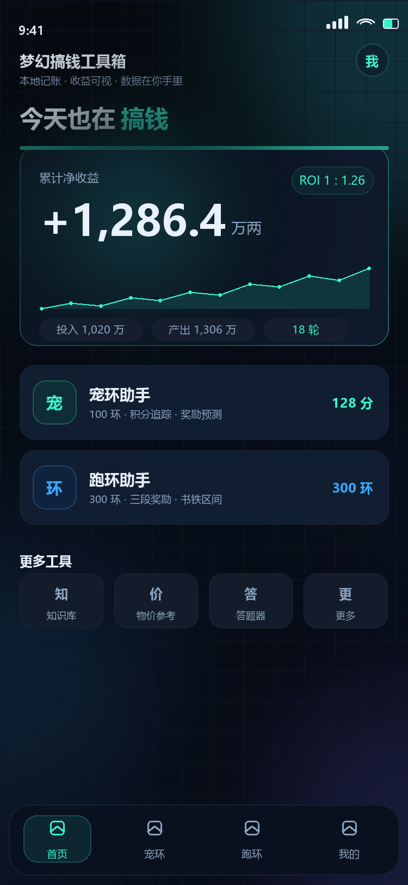
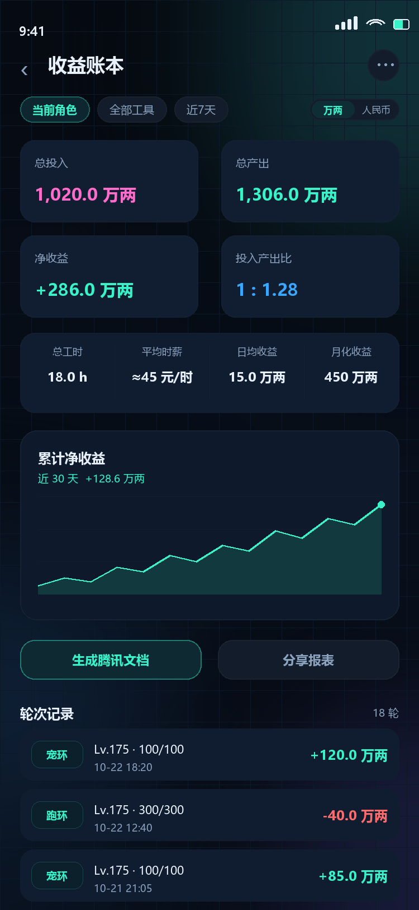
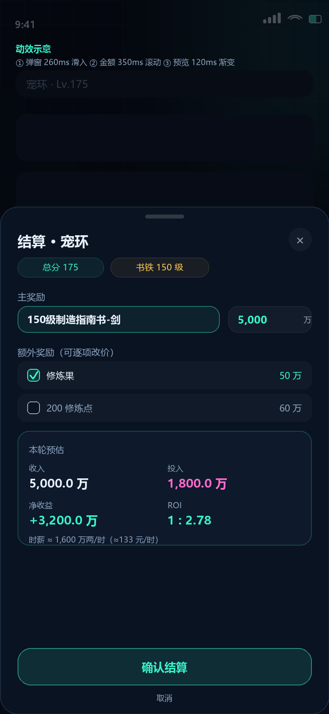
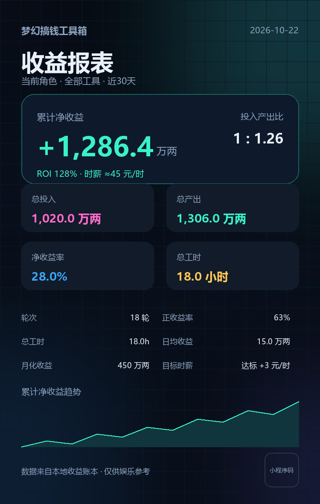

# v1.4 界面美化 + 动效方案（待确认）

> 目标：在不牺牲记账效率的前提下，把界面从「能用的深色工具」升级成「有科技感、动效顺滑、愿意截图分享」的产品。
> 效果图：`docs/design/mockup-home.png`、`mockup-ledger.png`、`mockup-settle.png`、`mockup-poster.png`
> 状态：**P0 + P1 已落地**（首页/账本深空霓虹视觉、动效基础、TabBar、半屏腾讯文档）；P2/P3（结算弹窗、明细抽屉、我的页、分享海报重做、减少动态开关、真机性能）待做。

---

## 1. 现在的问题

- 视觉层级偏平：卡片、按钮、背景都是同一层深色，重点数字不够抓眼。
- 动效基本为零：页面切换、弹出层、筛选、结算预览都是硬切，缺少「响应感」。
- 图标混用 emoji 与文字，风格不统一，分享出去不够「像个产品」。
- 信息密度高但没有节奏：账本页一屏塞了筛选、汇总、指标、图表、按钮、列表，视觉上容易累。

---

## 2. 视觉方向

### 主推：深空霓虹 · 全息账本

- 底色保持深色（#060a12 → #0a1322 渐变），叠加极淡的网格与角落光晕，营造「数据面板」感。
- 卡片用「半透明玻璃 + 细渐变描边 + 顶部高光」，不是纯色块。
- 主色从单一青绿扩展为「青绿 → 冰蓝」渐变，收益用青绿、成本用粉、警示用琥珀。
- 关键数字加轻微外发光；ROI/时薪用胶囊标签；按钮用渐变描边 + 内发光。
- 结构上做减法：一屏只留一个视觉重点（首页=累计净收益，账本=净收益+ROI，结算=本轮预估）。

### 备选

- B. 玻璃浅色：白底 + 毛玻璃 + 低饱和蓝绿。更「办公」，但夜间使用刺眼，且改动面更大。
- C. 极简黑白：去掉彩色和光效，只靠字重与留白。高级但不够「梦幻/搞钱」的调性。

### 设计 token（草案）

| 类别 | 值 |
|---|---|
| 背景 | `#060a12 → #0a1322` 线性渐变 + 2~3 处 6% 光晕 |
| 卡片 | `rgba(18,30,50,0.92)` + `1px rgba(120,180,220,0.10)` 描边，圆角 24~32rpx |
| 主色 | `#38f2c8`（青绿）、`#3aa7ff`（冰蓝）、渐变 `135deg` |
| 辅助色 | 成本 `#ff6bcb`、警示 `#ffc857`、危险 `#ff6b6b` |
| 文字 | 主 `#e8f0fa`、次 `#8ba3bf`、弱 `#5f7590` |
| 字号 | 大数字 64~80rpx、标题 40rpx、卡片值 36rpx、正文 28rpx、标签 20~22rpx |
| 间距 | 8rpx 基准；页面左右 36rpx；卡片内 28rpx；组间距 24rpx |
| 圆角 | 卡片 24~32rpx，按钮 999rpx（胶囊）或 24rpx |
| 阴影/光 | 卡片 `0 10rpx 34rpx rgba(0,0,0,.35)`；重点数字用预烘焙渐变光，不在运行时做 blur |

---

## 3. 动效系统

### 原则

1. **动效服务层级**：只让「变了的/该注意的」动，不整页乱飞。
2. **轻**：只动 `transform` 和 `opacity`，不动宽高、top、box-shadow；不引入 Lottie/GSAP。
3. **快**：交互反馈 120~180ms，页面级 240~320ms；超过 400ms 只在「数字滚动/图表绘制」出现。
4. **可降级**：低端机/系统减少动态效果时，关掉数字滚动、光晕呼吸、图表逐点绘制。

### 时间与曲线

| Token | 值 | 用途 |
|---|---|---|
| instant | 120ms `ease-out` | 按压、颜色变化、输入聚焦 |
| fast | 180ms `cubic-bezier(.2,0,0,1)` | 筛选、勾选、按钮反馈 |
| base | 240~260ms `cubic-bezier(.2,0,0,1)` | 卡片入场、弹窗滑入 |
| slow | 360ms `cubic-bezier(.16,1,.3,1)` | 抽屉、页面级过渡 |
| count | 500~600ms | 数字滚动（一次性） |
| chart | 600ms | 折线逐段绘制 |

### 动效清单

| 页面/元素 | 触发 | 效果 | 时长/曲线 | 实现 |
|---|---|---|---|---|
| 首屏 | 启动/返回 | 内容淡入 + 卡片依次上移 12rpx（stagger 40ms） | 260ms | CSS keyframes，`animation-delay` |
| 首页大数字 | 首次展示 | 0 → 目标值滚动 | 600ms | JS 分帧 setData（15~20 帧）或 canvas 数字 |
| 首页大栏目 | 点击 | 整卡 scale 0.98 → 1，光晕加深 | 180ms | `:active` + transition |
| 工具卡 | 点击 | 缩放 + 轻震动 | 150ms | `:active` + `wx.vibrateShort`（已有开关） |
| 底部 TabBar | 切换 | 活跃胶囊左右滑动，图标点亮 | 220ms | 绝对定位胶囊 `transform: translateX` |
| 账本筛选 chip | 选中 | 胶囊底滑块移动，文字颜色渐变 | 200ms | 同一容器内滑块 + transition |
| 账本汇总卡 | 进入/筛选变化 | 4 卡 stagger 50ms，数字滚动 | 500ms | 同上 |
| 账本折线 | 进入/筛选变化 | 从左到右画出，面积同步淡入 | 600ms | canvas 逐帧绘制（≤30fps），仅当前 tab 可见时执行 |
| 轮次列表 | 进入 | 每行上移 8rpx + 淡入，stagger 30ms | 240ms | CSS `animation-delay`（最多前 8 行） |
| 明细抽屉 | 打开/关闭 | 底部滑入 280ms 弹性；遮罩淡入 180ms | 280ms | `transform: translateY` + 遮罩 opacity |
| 结算弹窗 | 弹出 | 遮罩淡入 + 面板从底部滑入，把手轻微回弹 | 260ms | 同上 |
| 奖励 chip | 选中 | 边框点亮 + 勾选弹出 | 160ms | `:active`/class transition |
| 金额输入 | 输入 | 预览数字颜色渐变（正绿/负红），底部小进度条 | 120ms | 值变化时 class 切换 |
| 确认结算 | 提交成功 | 按钮内勾选绘制 + 卡片收拢，再跳历史 | 300ms | CSS + 定时 setData |
| 生成文档/分享报表 | 点击 | 按钮进入 loading 流光；海报生成后预览缩放淡入 | 200ms | CSS shimmer + 预览 opacity/scale |
| 空状态 | 无数据 | 图标轻浮动（4s 循环，可关闭） | 4s | CSS keyframes；低端机关闭 |

> 动效总量控制在「一屏同时最多 2 组动画」，避免炫技拖慢操作。

---

## 4. 页面级改造

### 首页

- 顶部品牌行 + 一句「今天也在搞钱」的标语（轻松、有记忆点）。
- 收益账本大栏目：净收益大数字 + ROI 胶囊 + 30 天迷你曲线 + 投入/产出/轮次胶囊。
- 工具卡改为「图标块 + 标题 + 说明 + 右侧指标」，点击有按压反馈。
- 快捷工具收成 4 个小卡，统一线性图标（替换 emoji）。
- 底部 TabBar 活跃项用发光胶囊，切换时滑动。

### 收益账本

- 顶部：返回 + 标题 + 右上「更多」。
- 筛选区：角色/工具/周期用可滑动胶囊；右侧「万两/人民币」分段开关。
- 汇总：2×2 玻璃卡（总投入/总产出/净收益/ROI），净收益卡加渐变描边；下方一条工时/时薪/日均/月化指标带。
- 图表：大卡承载累计净收益，进入时绘制动画，末点呼吸光点。
- 操作区：「生成腾讯文档」「分享报表」并排，主次分明。
- 列表：每条改为「工具标签 + 等级/完成 + 时间 + 净收益 + ROI」两行结构，点击进明细抽屉。

### 结算弹窗

- 顶部把手 + 标题 + 关闭；总分/书铁用胶囊。
- 主奖励一行：选中态高亮描边；右侧直接改价。
- 额外奖励行：勾选 + 价格，勾选动画。
- 「本轮预估」卡：收入/投入/净收益/ROI 四宫格，时薪附注；数字变化渐变。
- 底部确认按钮用渐变描边 + 内发光，点击后按钮内出现勾选动画。

### 我的

- 账号卡 + 收益账本大卡（与首页同款，缩小版）。
- 数据同步/角色管理保持列表，但列表项加图标底与箭头。
- 服务区保留四宫格，但图标统一。

### 分享海报（重做）

- 深空渐变 + 网格 + 光晕，顶部品牌与日期，大号净收益 + ROI。
- 4 张玻璃卡 + 指标两列 + 面积折线图 + 二维码占位（后续放小程序码）。
- 分享图与页面视觉统一，用户愿意发到群里。

---

## 5. 可用性与一致性

- 所有可点击元素热区 ≥ 88rpx；列表行 96~112rpx。
- 数字统一等宽（PingFang/微软雅黑下用 tabular 效果），右对齐；万两/元单位缩小一号。
- 加载态：骨架屏（账本首次进入、生成文档/海报时按钮流光）。
- 空状态：一句人话 + 一个主 CTA（去宠环/去跑环），不要只放图标。
- 错误态：toast + 可重试；网络/权限失败给「去设置」。
- 减少动态：设置页加「动效：完整/精简」开关（默认完整，低端机自动精简）。
- 图标：统一换成 20 个左右线性图标（base64 或 iconfont 子集），emoji 只保留在文案里。

---

## 6. 性能与兼容

- 所有动画走 CSS `transform/opacity`，避免 `filter: blur` 运行时动画（光晕用预烘焙渐变或静态 PNG）。
- 数字滚动最多 20 帧；图表逐帧绘制只在当前页面可见时执行，离开页面即停。
- 首屏不阻塞：先渲染静态内容，再做入场动画；骨架屏不超过 300ms。
- 列表动画最多前 8 行，避免长列表一次性创建大量动画。
- 支持「减少动态效果」：读取系统设置或本地开关，直接跳过非必要动画。
- 不新增第三方动画库，包体积增量控制在 < 30KB（图标 + 样式）。

---

## 7. 实施分期

| 阶段 | 内容 | 人日 |
|---|---|---|
| P0 设计基建 | design token、app.wxss 重构、通用卡片/胶囊/按钮/动效类、图标替换 | 1.5~2 |
| P1 首页 + 账本 | 两页静态视觉重做 + 筛选滑块 + 数字滚动 + 图表动画 + 列表入场 | 2~3 |
| P2 结算 + 明细 + 我的 + TabBar | 弹窗滑入、输入反馈、动效抽屉、TabBar 滑动、我的页改版 | 2 |
| P3 分享海报 + 打磨 | 海报重做、loading/空态/错误态、减少动态开关、性能与真机验收 | 1.5 |
| 合计 | | **7~8.5 人日** |

---

## 8. 验收标准

- 视觉：按效果图落地，深浅层次、描边、光晕、字号层级一致；深浅色对比度可读。
- 动效：中端安卓机（或 DevTools 性能面板）无掉帧；页面切换不白屏；无布局跳动。
- 降级：低端机/减少动态模式关闭滚动与图表绘制后功能不受影响。
- 可用性：所有按钮热区达标；裸眼看不到 1px 错位；空/错/加载三态齐全。
- 回归：现有 63 个单测、21 项验收全部通过；新增视觉/动效不影响业务逻辑。

---

## 9. 效果图

| 图 | 文件 |
|---|---|
| 首页 |  |
| 收益账本 |  |
| 结算弹窗（含动效标注） |  |
| 分享海报 |  |

> 效果图为视觉方向示意（750×1624 逻辑像素），实际按 rpx 与机型安全区适配；部分间距会在真机上收紧。

---

## 10. 需要你确认

1. **视觉方向**：主推「深空霓虹·全息账本」；还是想看 B 玻璃浅色 / C 极简黑白？
2. **动效强度**：克制版（推荐，只保留关键动效）还是丰富版（更多入场与光效）？
3. **图标**：是否同意把 emoji 换成统一线性图标（需要一套 ~20 个图标，我可以直接画成 base64）？
4. **范围**：一期是否包含「分享海报重做」；还是先做首页 + 账本，结算/我的放二期？
5. **浅色主题**：暂时不做（工作量 +30%），只做深色，可以吗？

---

## 11. 已落地（2026-10-22，P0+P1）

- 首页、收益账本、底部 TabBar 已按「深空霓虹」改造：玻璃卡、渐变描边、光晕、胶囊筛选、迷你趋势条、入场动效；账本图表改为逐帧绘制。
- 真实截图：`docs/design/real-home.png`、`docs/design/real-ledger.png`。
- 腾讯文档跳转改为**优先半屏** `wx.openEmbeddedMiniProgram`，失败自动降级普通小程序跳转/复制链接。
- `docsReport` 云函数已改为纯环境变量（本地兜底文件已删除并重新部署，3 个文件）。
- 回归：64 个单测通过、`accept 21/21`、lint 0 告警。

### 待做（P2/P3）

- 结算弹窗与明细抽屉的动效升级、我的页收益卡与新图标体系。
- 分享海报按 mockup-poster 重做；减少动态效果开关；真机性能验收。
